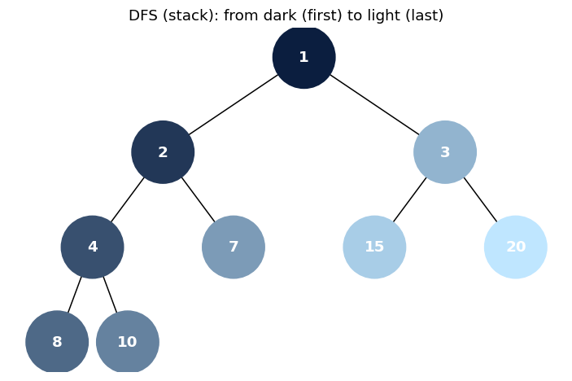
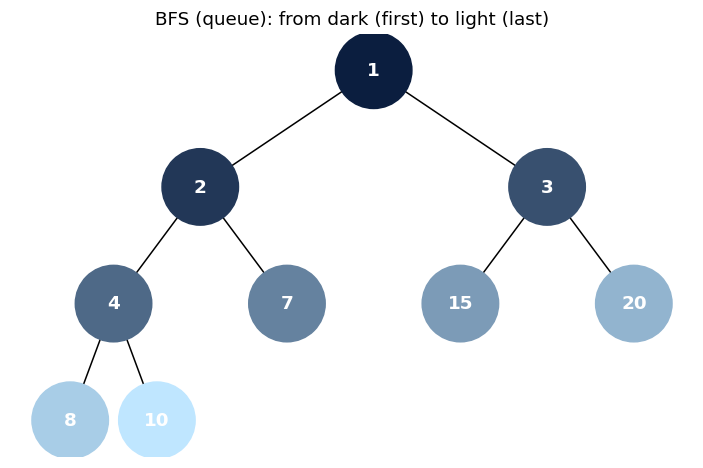
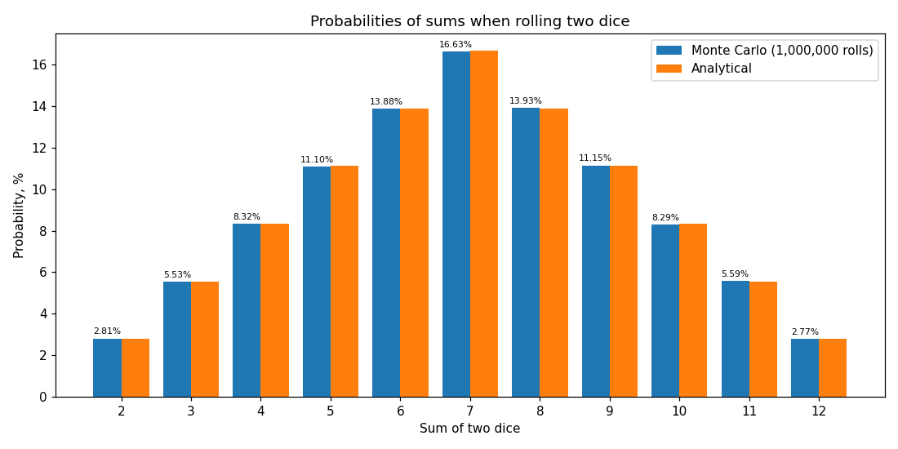

# Final project (goit-algo-fp)

Final project of the "Basic Algorithms and Data Structures 2.0" course.

## Setup

```bash
cd fp
pip install -r requirements.txt
```

## Files

| File | Task |
|---|---|
| `task1_linked_list.py` | 1. Singly linked list: reversal, merge sort, merging two sorted lists |
| `task2_pythagoras_tree.py` | 2. "Pythagoras tree" fractal (recursion), recursion level set by the user |
| `task3_dijkstra.py` | 3. Dijkstra's algorithm with a binary heap (`heapq`) |
| `tree_viz.py` | Base binary tree drawing code (shared by tasks 4 and 5) |
| `task4_heap_visualization.py` | 4. Binary heap visualization |
| `task5_tree_traversal.py` | 5. DFS (stack) and BFS (queue) traversal visualization, colors from dark to light |
| `task6_food_budget.py` | 6. Greedy algorithm and dynamic programming for choosing food within a budget |
| `task7_monte_carlo.py` | 7. Monte Carlo method for the sum of two dice |
| `images/` | Saved visualization results |

## Running

```bash
python task1_linked_list.py
python task2_pythagoras_tree.py        # the program asks for the recursion level
python task2_pythagoras_tree.py 8      # or pass it as an argument
python task3_dijkstra.py
python task4_heap_visualization.py
python task5_tree_traversal.py
python task6_food_budget.py
python task7_monte_carlo.py
```

## Results

### Task 1

```
Original list:    5 -> 1 -> 9 -> 3 -> 7 -> 2
After reversal:   2 -> 7 -> 3 -> 9 -> 1 -> 5
After sorting:    1 -> 2 -> 3 -> 5 -> 7 -> 9
Merged (A + B):   1 -> 2 -> 3 -> 4 -> 6 -> 8 -> 10 -> 11 -> 12
```

Reversal re-points the `next` links between nodes (O(n), no extra memory).
Sorting uses merge sort (O(n log n)): the list is split in half with slow/fast pointers and the halves are merged.
Merging two sorted lists relinks the existing nodes in O(n + m).

### Task 2


### Task 3

```
Shortest paths from vertex A:
  A: distance   0   path: A
  B: distance   4   path: A -> B
  C: distance   2   path: A -> C
  D: distance   9   path: A -> C -> E -> D
  E: distance   5   path: A -> C -> E
  F: distance  14   path: A -> C -> E -> F
```

The vertex with the smallest current distance is taken from the binary heap in O(log V); overall complexity is O((V + E) log V).

### Task 4

The heap is stored as an array: the children of element `i` are at indices `2i + 1` and `2i + 2`.
`heap_to_tree` turns that array into a tree of `Node` objects, which is drawn with the code from the assignment.


### Task 5

Both traversals are implemented without recursion: DFS uses a stack, BFS uses a queue (`deque`).
Each visited node gets a unique `#RRGGBB` color, from dark (`#0B1E3F`, first) to light (`#BFE6FF`, last).

| DFS (stack) | BFS (queue) |
|---|---|
|  |  |

Step-by-step visualization: [DFS](images/dfs_steps.png), [BFS](images/bfs_steps.png).

### Task 6

| Budget | Greedy algorithm | Calories | Dynamic programming | Calories |
|---|---|---|---|---|
| 50 | cola, potato, pepsi | 670 | pepsi, cola, potato | 670 |
| 100 | cola, potato, pepsi, hot-dog | 870 | pizza, pepsi, cola, potato | **970** |
| 120 | cola, potato, pepsi, hot-dog, hamburger | 1120 | hamburger, hot-dog, pepsi, cola, potato | 1120 |

The greedy algorithm takes dishes in descending order of the calories/cost ratio. It is fast but not always optimal:
with a budget of 100 it spends only 80 and gets 870 calories, while dynamic programming (0/1 knapsack, O(n · budget))
finds the optimal set worth 970 calories.

### Task 7. Monte Carlo method: conclusions

**1,000,000** rolls of two dice were simulated.



| Sum | Monte Carlo | Analytical | Difference |
|---|---|---|---|
| 2 | 2.81% | 2.78% (1/36) | +0.029% |
| 3 | 5.53% | 5.56% (2/36) | −0.022% |
| 4 | 8.32% | 8.33% (3/36) | −0.017% |
| 5 | 11.10% | 11.11% (4/36) | −0.011% |
| 6 | 13.88% | 13.89% (5/36) | −0.005% |
| 7 | 16.63% | 16.67% (6/36) | −0.037% |
| 8 | 13.93% | 13.89% (5/36) | +0.043% |
| 9 | 11.15% | 11.11% (4/36) | +0.036% |
| 10 | 8.29% | 8.33% (3/36) | −0.042% |
| 11 | 5.59% | 5.56% (2/36) | +0.030% |
| 12 | 2.77% | 2.78% (1/36) | −0.005% |

How accuracy depends on the number of rolls (max deviation from the exact values):

| Rolls | 100 | 1,000 | 10,000 | 100,000 | 1,000,000 |
|---|---|---|---|---|---|
| Deviation | 7.33% | 1.49% | 0.37% | 0.21% | 0.04% |

**Conclusions:**

1. The Monte Carlo results practically match the analytical ones: with one million rolls the largest deviation is only 0.043 percentage points.
2. The shape of the distribution is the same: the most likely sum is 7 (≈16.7%), the least likely are 2 and 12 (≈2.8%), and the distribution is symmetric around 7.
3. The more rolls, the closer the result is to the exact value (law of large numbers): the error shrinks roughly as 1/√N, from ~7% at 100 rolls to ~0.04% at one million.
4. So the analytical calculations are correct, and the Monte Carlo method gives a reliable estimate of the probabilities with enough simulations.
