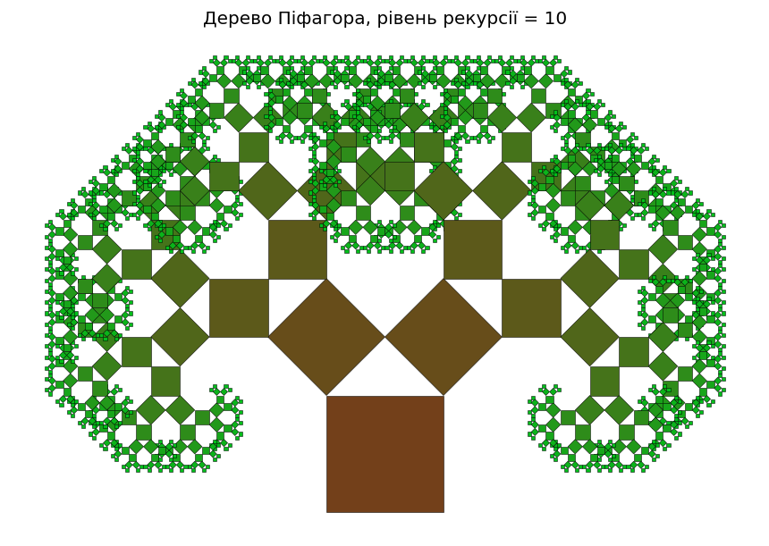
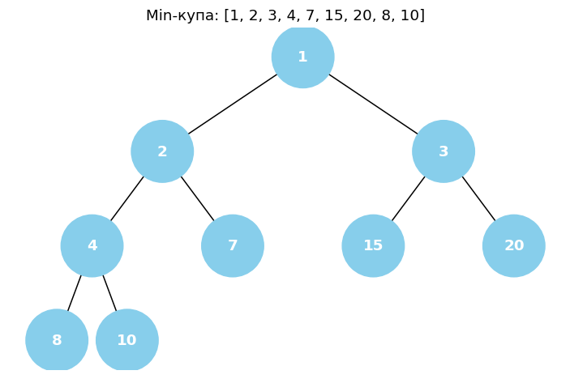

# Фінальний проєкт (goit-algo-fp)

Фінальний проєкт курсу «Basic Algorithms and Data Structures 2.0».

## Встановлення

```bash
cd fp
pip install -r requirements.txt
```

## Файли

| Файл | Завдання |
|---|---|
| `task1_linked_list.py` | 1 — однозв'язний список: реверсування, сортування злиттям, об'єднання двох відсортованих списків |
| `task2_pythagoras_tree.py` | 2 — фрактал «дерево Піфагора» (рекурсія), рівень рекурсії задає користувач |
| `task3_dijkstra.py` | 3 — алгоритм Дейкстри з бінарною купою (`heapq`) |
| `tree_viz.py` | базовий код побудови бінарного дерева (спільний для завдань 4 і 5) |
| `task4_heap_visualization.py` | 4 — візуалізація бінарної купи |
| `task5_tree_traversal.py` | 5 — візуалізація обходів DFS (стек) і BFS (черга) з кольорами від темного до світлого |
| `task6_food_budget.py` | 6 — жадібний алгоритм і динамічне програмування для вибору їжі в межах бюджету |
| `task7_monte_carlo.py` | 7 — метод Монте-Карло для сум двох кубиків |
| `images/` | збережені результати візуалізацій |

## Запуск

```bash
python task1_linked_list.py
python task2_pythagoras_tree.py        # програма запитає рівень рекурсії
python task2_pythagoras_tree.py 8      # або передайте його аргументом
python task3_dijkstra.py
python task4_heap_visualization.py
python task5_tree_traversal.py
python task6_food_budget.py
python task7_monte_carlo.py
```

## Результати

### Завдання 1

```
Початковий список:      5 -> 1 -> 9 -> 3 -> 7 -> 2
Після реверсування:     2 -> 7 -> 3 -> 9 -> 1 -> 5
Після сортування:       1 -> 2 -> 3 -> 5 -> 7 -> 9
Об'єднаний (A + B):     1 -> 2 -> 3 -> 4 -> 6 -> 8 -> 10 -> 11 -> 12
```

Реверсування змінює посилання `next` між вузлами (O(n), без додаткової пам'яті).
Сортування — злиттям (O(n log n)): список ділиться навпіл повільним/швидким вказівником, половини зливаються.
Об'єднання двох відсортованих списків переставляє наявні вузли за O(n + m).

### Завдання 2



### Завдання 3

```
Найкоротші шляхи від вершини A:
  A: відстань   0   шлях: A
  B: відстань   4   шлях: A -> B
  C: відстань   2   шлях: A -> C
  D: відстань   9   шлях: A -> C -> E -> D
  E: відстань   5   шлях: A -> C -> E
  F: відстань  14   шлях: A -> C -> E -> F
```

Вершина з найменшою поточною відстанню дістається з бінарної купи за O(log V), загальна складність O((V + E) log V).

### Завдання 4

Купа зберігається масивом: нащадки елемента `i` мають індекси `2i + 1` і `2i + 2`.
Функція `heap_to_tree` перетворює цей масив на дерево з вузлів `Node`, яке малюється кодом із завдання.



### Завдання 5

Обходи реалізовано без рекурсії: DFS — через стек, BFS — через чергу (`deque`).
Кожен відвіданий вузол отримує унікальний колір `#RRGGBB` — від темного (`#0B1E3F`, перший) до світлого (`#BFE6FF`, останній).

| DFS (стек) | BFS (черга) |
|---|---|
|  |  |

Покрокова візуалізація: [DFS](images/dfs_steps.png), [BFS](images/bfs_steps.png).

### Завдання 6

| Бюджет | Жадібний алгоритм | Калорії | Динамічне програмування | Калорії |
|---|---|---|---|---|
| 50 | cola, potato, pepsi | 670 | pepsi, cola, potato | 670 |
| 100 | cola, potato, pepsi, hot-dog | 870 | pizza, pepsi, cola, potato | **970** |
| 120 | cola, potato, pepsi, hot-dog, hamburger | 1120 | hamburger, hot-dog, pepsi, cola, potato | 1120 |

Жадібний алгоритм бере страви за спаданням співвідношення «калорії / вартість». Він швидкий, але не завжди оптимальний:
при бюджеті 100 він витрачає лише 80 і отримує 870 калорій, а динамічне програмування (рюкзак 0/1, O(n · budget))
знаходить оптимальний набір на 970 калорій.

### Завдання 7. Метод Монте-Карло — висновки

Змодельовано **1 000 000** кидків двох кубиків.


| Сума | Монте-Карло | Аналітично | Різниця |
|---|---|---|---|
| 2 | 2.81% | 2.78% (1/36) | +0.029% |
| 3 | 5.53% | 5.56% (2/36) | −0.022% |
| 4 | 8.32% | 8.33% (3/36) | −0.017% |
| 5 | 11.10% | 11.11% (4/36) | −0.011% |
| 6 | 13.88% | 13.89% (5/36) | −0.005% |
| 7 | 16.63% | 16.67% (6/36) | −0.037% |
| 8 | 13.93% | 13.89% (5/36) | +0.043% |
| 9 | 11.15% | 11.11% (4/36) | +0.036% |
| 10 | 8.29% | 8.33% (3/36) | −0.042% |
| 11 | 5.59% | 5.56% (2/36) | +0.030% |
| 12 | 2.77% | 2.78% (1/36) | −0.005% |

Як точність залежить від кількості кидків (максимальне відхилення від точних значень):

| Кидків | 100 | 1 000 | 10 000 | 100 000 | 1 000 000 |
|---|---|---|---|---|---|
| Відхилення | 7.33% | 1.49% | 0.37% | 0.21% | 0.04% |

**Висновки:**

1. Результати методу Монте-Карло практично збігаються з аналітичними: при мільйоні кидків найбільше відхилення — лише 0.043 процентного пункту.
2. Форма розподілу та сама: найімовірніша сума — 7 (≈16.7%), найменш імовірні — 2 і 12 (≈2.8%), розподіл симетричний відносно 7.
3. Чим більше кидків, тим ближчий результат до точного (закон великих чисел): похибка зменшується приблизно як 1/√N — від ~7% при 100 кидках до ~0.04% при мільйоні.
4. Отже, аналітичні розрахунки правильні, а метод Монте-Карло дає надійну оцінку ймовірностей за достатньої кількості симуляцій.
