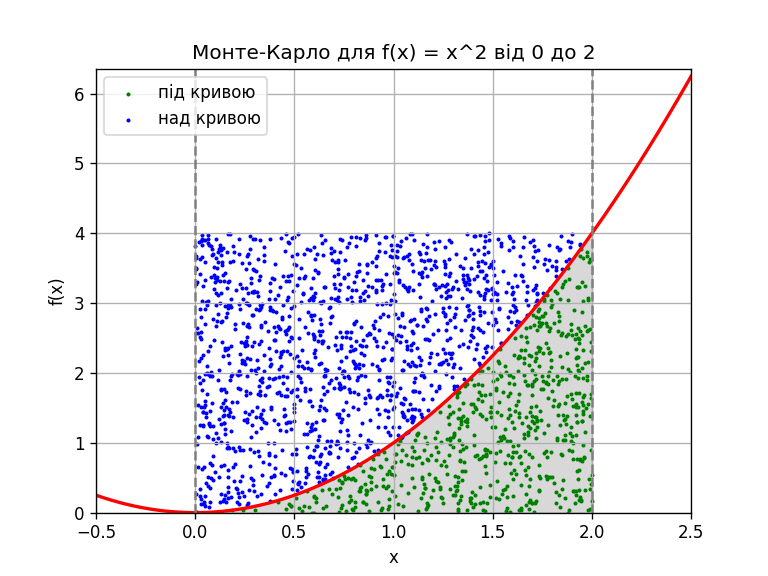

# goit-algo-hw-10

Домашнє завдання до тем 9 «Жадібні алгоритми та динамічне програмування» і 10 «Лінійне програмування та рандомізовані алгоритми».

## Файли

- `task1_coins.py` — завдання 1: `find_coins_greedy` (жадібний алгоритм) і `find_min_coins` (динамічне програмування) для видачі решти монетами `[50, 25, 10, 5, 2, 1]`, перевірка і заміри часу.
- `task2_monte_carlo.py` — завдання 2: інтеграл `f(x) = x^2` на `[0, 2]` методом Монте-Карло, порівняння з аналітичним розв'язком і `scipy.integrate.quad`.
- `monte_carlo.png` — графік: функція, площа під нею і випадкові точки.

Запуск (Python 3.9+, потрібні `numpy`, `scipy`, `matplotlib`), з папки `hw_10`:

```bash
python task1_coins.py
python task2_monte_carlo.py
```

## Завдання 1. Видача решти

Для суми 113:

- `find_coins_greedy(113)` → `{50: 2, 10: 1, 2: 1, 1: 1}`
- `find_min_coins(113)` → `{1: 1, 2: 1, 10: 1, 50: 2}`

**Як працюють.**

- **Жадібний алгоритм** проходить номінали від найбільшого до найменшого і для кожного одним діленням з остачею бере стільки монет, скільки вміщується. Складність **O(k)**, де k — кількість номіналів (тут 6). Від суми час практично не залежить.
- **Динамічне програмування** будує таблицю `min_coins[s]` — найменшу кількість монет для кожної суми `s` від 1 до `amount`. Для кожної суми перебирає всі номінали: `min_coins[s] = min(min_coins[s - coin] + 1)`. Окремо запам'ятовує, якою монетою закінчується оптимальний набір, щоб потім відновити відповідь. Складність **O(amount · k)** за часом і **O(amount)** за пам'яттю.

**Заміри часу** (найкращий із 3 запусків):

| Сума      | Жадібний, мс | ДП, мс  | Монет (жадібний / ДП) |
|----------:|-------------:|--------:|----------------------:|
| 113       | 0.0023       | 0.15    | 5 / 5                 |
| 1 000     | 0.0033       | 1.28    | 20 / 20               |
| 10 000    | 0.0019       | 12.88   | 200 / 200             |
| 100 000   | 0.0022       | 143.50  | 2 000 / 2 000         |
| 1 000 000 | 0.0020       | 1364.34 | 20 000 / 20 000       |

Точні числа залежать від комп'ютера, але картина однакова.

**Висновки.**

- Час жадібного алгоритму не росте разом із сумою: для 113 і для мільйона він однаковий (~0.002 мс). Час ДП росте лінійно: сума в 10 разів більша — час приблизно в 10 разів більший. Для мільйона ДП працює вже ~1.4 с і тримає в пам'яті дві таблиці по мільйону елементів.
- Для набору `[50, 25, 10, 5, 2, 1]` жадібний алгоритм завжди дає оптимальну кількість монет. Скрипт перевіряє це для всіх сум від 0 до 1000: обидва алгоритми дають однакову кількість монет. Такі набори монет називають канонічними.
- Тому для цієї касової системи краще використовувати **жадібний алгоритм**: результат той самий, а при великих сумах він швидший на кілька порядків і майже не потребує пам'яті.
- ДП потрібне, коли набір монет не канонічний. Наприклад, для монет `[4, 3, 1]` і суми 6 жадібний алгоритм дає `4 + 1 + 1` (3 монети), а ДП знаходить `3 + 3` (2 монети). ДП завжди гарантує мінімум, жадібний — лише для «зручних» наборів.

## Завдання 2. Інтеграл методом Монте-Карло

Функція `f(x) = x^2`, межі `[0, 2]`.

**Аналітично:** ∫₀² x² dx = x³/3 |₀² = 8/3 ≈ **2.666667**.
**SciPy `quad`:** 2.666667, оцінка похибки 3·10⁻¹⁴.

Реалізовано два варіанти методу Монте-Карло:

- **Метод «влучань»**: кидаємо випадкові точки в прямокутник `[0, 2] × [0, 4]` (площа 8) і рахуємо частку точок під графіком. Інтеграл ≈ частка влучань × 8.
- **Метод середнього значення**: беремо випадкові `x` на `[0, 2]`, рахуємо середнє `f(x)` і множимо на довжину відрізка 2.

Точки генеруються порціями по 100 000, тому навіть мільйон точок не займає багато пам'яті.

| N         | Влучання | Похибка | Середнє | Похибка |
|----------:|---------:|--------:|--------:|--------:|
| 100       | 2.72000  | 2.00%   | 2.52855 | 5.18%   |
| 1 000     | 2.60800  | 2.20%   | 2.62557 | 1.54%   |
| 10 000    | 2.60000  | 2.50%   | 2.66045 | 0.23%   |
| 100 000   | 2.67272  | 0.23%   | 2.65819 | 0.32%   |
| 1 000 000 | 2.66206  | 0.17%   | 2.66458 | 0.08%   |

20 незалежних запусків по 100 000 точок:

- влучання: середнє 2.66870, стандартне відхилення 0.01004;
- середнє значення: середнє 2.66540, стандартне відхилення 0.00547.

(Генератор випадкових чисел із фіксованим `seed=42`, тому результати відтворюються.)



**Висновки.**

- Метод Монте-Карло дає правильний результат: при 1 000 000 точок похибка 0.17% і 0.08% відносно точного значення 8/3, яке також підтверджує `quad`. Розрахунки правильні.
- Чим більше точок, тим точніше, але повільно: похибка зменшується приблизно як 1/√N. Щоб зменшити її в 10 разів, потрібно в 100 разів більше точок. На малих N результат «стрибає» (наприклад, на 10 000 влучань похибка навіть більша, ніж на 1 000), бо це випадковий процес.
- Метод середнього значення стабільніший за метод влучань: при однаковій кількості точок його розкид майже вдвічі менший (0.0055 проти 0.0100). Він використовує саме значення функції, а не лише відповідь «під/над кривою».
- Для такої простої функції `quad` точніший і швидший. Монте-Карло корисний, коли інтеграл важко або неможливо порахувати аналітично, зокрема для багатовимірних інтегралів: його точність не залежить від кількості вимірів.
